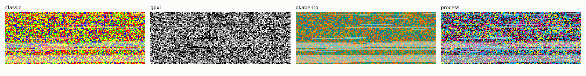
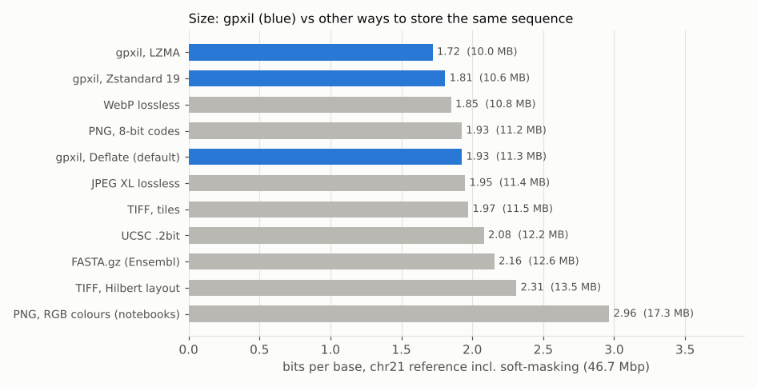
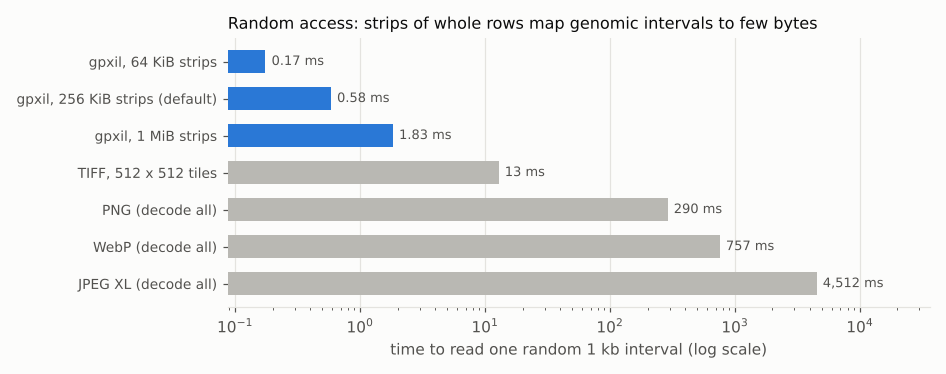
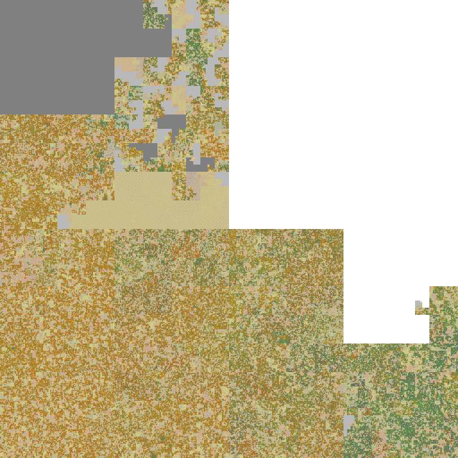
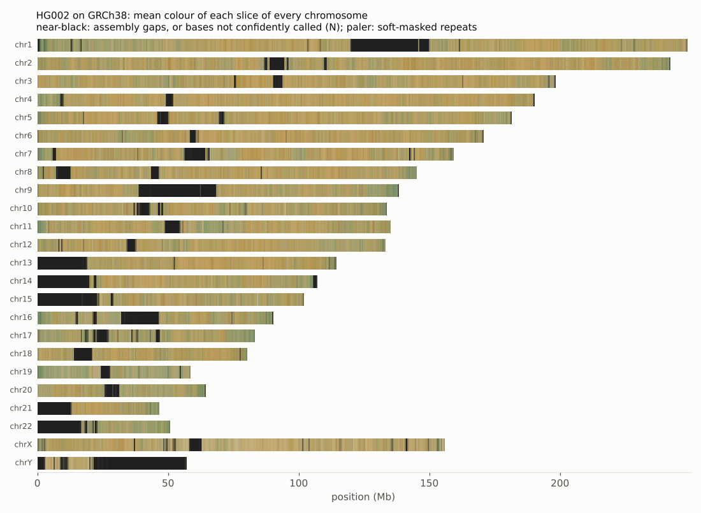
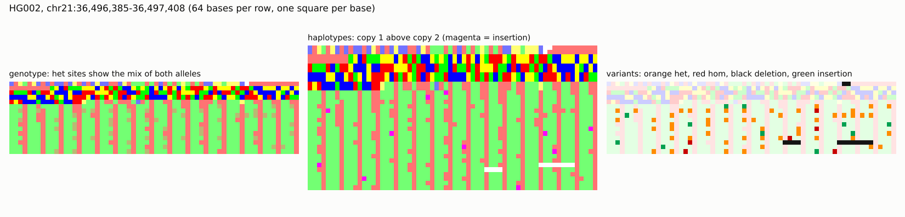
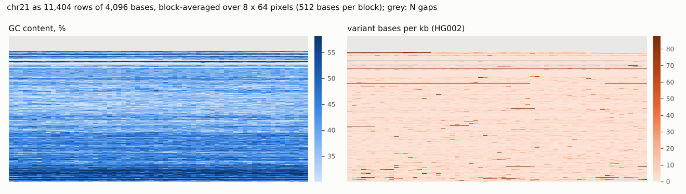
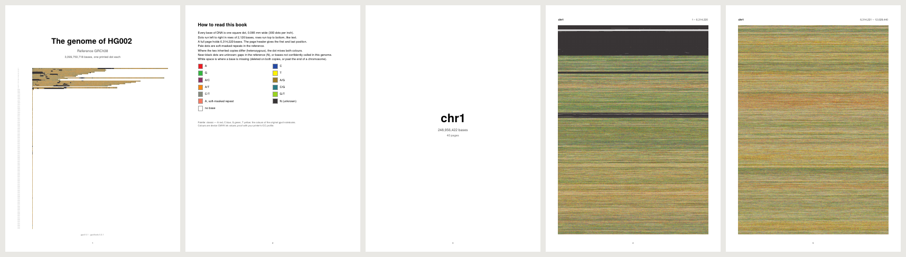

# Why gpxil looks the way it does

This note records the choices behind [SPEC.md](../SPEC.md) and the
measurements that settled them. All numbers come from
[`bench_representations.py`](https://github.com/comparativechrono/Gpxil-tools/blob/main/benchmarks/bench_representations.py)
in gpxiltools, run on real data:

- **Reference:** GRCh38 chromosome 21 from Ensembl release 116, soft-masked
  (`Homo_sapiens.GRCh38.dna_sm.chromosome.21.fa.gz`): 46,709,983 bases, of
  which 6,621,364 are N and 22,752,430 soft-masked. Whole-genome figures use
  the Ensembl 116 primary assembly (3,099,750,718 bases, 194 sequences).
- **Sample:** HG002 (Genome in a Bottle), small-variant benchmark v5.0q on
  GRCh38: 113,870 calls on chr21 and 5,945,525 genome-wide, fully phased,
  with haploid calls on X and Y, no-calls, spanning deletions (`*`) and
  indels up to 98 kb, plus its benchmark-region BED.
- **Machine:** 2 cores, Python 3.13, tifffile 2026.9.20, imagecodecs
  2026.10.10, Pillow 12.3. Times are wall-clock and only comparable with each
  other.

## 1. What the notebooks taught

The notebooks that preceded gpxil established that a chromosome can be drawn
one pixel per base and that it looks like something. They also showed where
an image *format* needs more care than an image:

| Observation in the notebooks | Consequence | In gpxil |
|---|---|---|
| Pictures were made with `plt.imshow` and `savefig`. The figure has margins and is resampled to `figsize × dpi`, so pixels are not bases. In the chrY settings (5,000 bases per row, 600 dpi) the picture had 0.93 pixels per base and only 72 % of bases could be read back even by nearest colour; at 500 bases per row and 150 dpi it had 2.3 pixels per base, and the exact colour survived at only 6 % of bases because of anti-aliasing. | lossy | arrays are written directly, one pixel per base, never through a plotting library |
| Bases were collected with `[color_map[b] for b in seq if b in color_map]`, which silently drops every character that is not uppercase `ACGT`. | every N and every lowercase base shifts all later positions; in a soft-masked FASTA that is most of the sequence (28.1 of chr21's 46.7 million bases, 60 %) | the mapping covers all IUPAC letters in both cases; offset `i` is always base `i + 1` |
| Colours were stored as float RGB arrays. | 24 bytes per base in memory (6 GB for chr1) | 1 byte per base per plane |
| The Pillow and Cairo versions set one pixel per Python call. | minutes per chromosome | a 256-entry lookup table encodes chr21 in 0.6 s |
| `apply_variants` applied the first ALT of every record whatever the genotype, compared only one REF base, and rebuilt the sequence string for each variant. | heterozygous sites became homozygous, indels were silently skipped, and run time grew with variants × length | per-haplotype states with zygosity, phase and indels (section 6 of the spec) |
| Compression was compared on a short motif repeated many times. | real DNA does not compress like that: 1.7-2.2 bits per base on chr21 | measured on real chromosomes below |
| A random CMYK image did not survive TIFF → PNG → TIFF through ICC profiles, and a correction table indexed by C and M could not fix it. | colour conversion is not invertible (section 2) | data are codes; colours only at render time |

## 2. Codes, not colours

The central decision is that a pixel holds a **code**, and colour is applied
when the image is shown or printed.

**Why not RGB channels?** With the notebook colours (A red, C blue, G green,
T yellow) the natural way to show a heterozygous site is to switch on both
alleles' channels. But yellow is red plus green, so an A/G heterozygote is
exactly a T, and so is A/T, G/T and A/G/T: five different IUPAC codes land on
(1, 1, 0) and five more on white. On chr21 alone, HG002 has 10,507 A/G
heterozygous positions that would print as T. Three channels cannot carry
four independent bases.

**Why not CMYK channels?** Four inks for four bases do fix the collision, and
the idea survives in gpxil, but as a palette (below), not as storage. Stored
as a 4-channel dosage image (0, 1 or 2 copies of each base per pixel) chr21
takes **15.4 MB** against **0.68 MB** for the gpxil `gt` and `flags` planes,
because a dosage image repeats the reference at every base instead of
recording differences from it. It also cannot represent phase (at the
230,576 phased positions of chr21 where the two haplotypes differ, it could
not say which haplotype carries what), insertions (7,793 positions), or the
difference between a deleted and an unknown base (341,209 positions). And CMYK pixel values do not survive a
colour-managed workflow: CMYK has four dimensions and RGB three, many CMYK
values print the same colour, and ICC conversions apply gamut mapping and
black generation, which is exactly what broke the round-trip notebook.

**What gpxil does instead.** The reference base is a 4-bit IUPAC set, one bit
per base, the encoding BAM uses. A heterozygous A/G site is the set {A, G},
code R; the genotype keeps each haplotype's state separately so nothing is
lost. A palette then maps codes to colours, defined separately in sRGB (for
screens) and CMYK (for presses), so neither is converted from the other. In
the `process` palette the 4-bit set is printed literally as one bit per
ink, A cyan, C magenta, G yellow, T black, so a heterozygous A/G site
overprints cyan and yellow. The CMYK intuition is right; it belongs at the
printer, not in the file.

## 3. The container: TIFF

Requirements: lossless; opens as a picture in ordinary software; one image
per chromosome and plane in one file; fast reads of arbitrary genomic
intervals; no size limits that a human chromosome hits; room for metadata
and a side table; readable from every language.

| Representation of chr21 | MB | bits/base | encode s | read any 1 kb, ms |
|---|---:|---:|---:|---:|
| FASTA.gz as distributed by Ensembl | 12.59 | 2.16 | | |
| UCSC .2bit | 12.16 | 2.08 | | |
| PNG, 24-bit RGB colours (notebook approach) | 17.31 | 2.96 | 111.9 | |
| PNG, 8-bit palette codes | 11.24 | 1.93 | 15.8 | 290 (whole image) |
| WebP lossless | 10.81 | 1.85 | 271.3 | 757 (whole image) |
| JPEG XL lossless, effort 7 | 11.39 | 1.95 | 18.3 | 4,512 (whole image) |
| TIFF, 512 × 512 tiles, Deflate | 11.52 | 1.97 | 4.7 | 12.9 |
| **gpxil TIFF, Deflate 9 (default)** | **11.25** | **1.93** | 5.1 | **0.58** |
| gpxil TIFF, Deflate 6 | 11.73 | 2.01 | 1.4 | 0.56 |
| gpxil TIFF, Zstandard 19 | 10.56 | 1.81 | 23.1 | 0.60 |
| gpxil TIFF, LZMA | 10.05 | 1.72 | 20.2 | 2.77 |
| FASTA.xz -9 (for reference) | 9.79 | 1.68 | 85.4 | |

- **PNG** compresses exactly as well as TIFF with Deflate, because it uses the
  same algorithm, but it is one stream: reading any interval means decoding
  the whole chromosome (0.3 s for chr21, about 1.5 s for chr1). It has no
  pages, so a genome would be dozens of files, and many viewers refuse images
  of hundreds of megapixels. It remains the right format for *renderings*.
- **WebP** lossless is 4 % smaller but limits images to 16,383 pixels a side
  (chromosome 1 at 8,192 bases per row is 30,391 rows), holds only RGB(A),
  and took 4.5 minutes to encode chr21.
- **JPEG XL** supports huge images and extra channels, but reading any part
  took 4.5 s at a competitive effort, and support in viewers and libraries is
  still patchy.
- **Zarr and HDF5** are excellent array stores (VCF Zarr already uses Zarr for
  cohorts) but they are not images: nothing shows a picture when the file is
  opened, and Zarr is a directory or zip of many files. A Zarr binding of the
  same data model is listed as future work.
- **TIFF** does everything required. Palette pages make every plane a
  coloured picture in any viewer while the pixel values stay codes; a
  multi-page file holds a whole genome; strips give random access; every
  TIFF library reads Deflate; Zstandard and LZMA are available where 6-11 %
  matters; BigTIFF lifts the 4 GiB limit; private tags hold the sidecar.
  TIFF is also the format Albrecht-Buehler used for his figures.

**Strips of whole rows, not tiles.** In the raster layout a genomic interval
is a run of consecutive rows, which is exactly a strip. Tiles split each row
across many tiles, so a random 1 kb read took 22 times longer (12.9 ms
against 0.58 ms). Strip size trades random-access cost against
compression: 64 KiB strips read a random kilobase in 0.17 ms for 2.5 % more
space; 1 MiB strips save 0.6 % (Deflate) to 3 % (Zstandard) but need
1.8 ms. gpxiltools uses 256 KiB.

**Deflate by default.** Zstandard 19 is 6 % smaller and LZMA 11 % smaller,
but Deflate (like the older LZW) is read by practically every TIFF reader,
while Zstandard and LZMA support depends on how a viewer's TIFF library was
built. Writers can choose; readers should support all three.

## 4. Planes, layout and bit depth

**One plane per page, 8 bits per base.** Packing the reference into 4 bits
per base plus a separate 1-bit soft-mask plane would save 7 % with Deflate
and 12 % with Zstandard (10.4 and 9.3 MB). But common TIFF writers cannot
compress 4-bit palette images, 4-bit pixels are awkward in image-analysis
code, and soft-masking would need its own plane. Version 0.1 stays at 8 bits;
a packed profile could be added later without changing the data model.

**Raster, not Hilbert.** A Hilbert curve keeps neighbouring bases together in
two dimensions, which suits image filters, but stored that way chr21 grew by
20 % (13.5 MB), because Deflate then sees bases in tile-row order rather than
sequence order, and a genomic interval no longer maps to one run of bytes.
Since any layout can be computed from the raster in a second, gpxil stores
the raster and offers Hilbert as a view.

**Width 8,192.** Any width works and readers can re-wrap; 8,192 bases per row
makes chr21 roughly square (5,702 rows) and keeps chr1 (30,391 rows) within
common viewers' limits.

## 5. Genotypes relative to the reference

The `gt` plane stores each haplotype's state *relative to the reference*:
REF is 0, so a person's genotype plane is almost entirely zeros and costs
very little. For HG002 on chr21 the `gt` and `flags` planes and the sidecar
together take **0.68 MB**, less than a gzipped VCF that keeps only the
genotype columns (0.74 MB) and well below the full VCF.gz (0.94 MB).
Genome-wide they take **39 MB**, against 42 MB for the distributed VCF.gz.

Each haplotype gets its own 4-bit state rather than, say, a zygosity code,
because that keeps:

- **phase**, by the order of the two nibbles;
- **haploid regions** (male X and Y outside the PARs), as ABSENT;
- the difference between **deleted** (DEL) and **unknown** (UNKNOWN);
- **multi-allelic** sites (`1|2` is two different bases);
- **per-haplotype deletions** that overlap other calls (the `*` alleles in
  HG002's calls combine correctly; see below).

Insertions happen between bases, so they are a flag on the base before
them and a sequence in the sidecar rather than a state.

**Correctness.** The conversion was checked against `bcftools consensus`.
On the 71,176 chr21 records that do not overlap each other (SNVs, MNPs,
indels and multi-allelic sites with known genotypes), both reconstructed
haplotypes (46.8 million bases each) are identical to bcftools' output
apart from soft-mask case at 427 and 389 bases, where bcftools gives a whole
allele the case of its first reference base and gpxil keeps the reference
case base by base. Where records overlap,
bcftools skips the later record, while gpxil applies both, following the
`*` alleles: in a VNTR at chr21:16,747,387 HG002 carries an 81 bp deletion on
haplotype 1 (first record) and an 83 bp deletion on haplotype 2 (second
record), and bcftools drops the second. Exporting the chr21 file back to VCF
(107,225 records) and re-encoding it reproduces both haplotype sequences,
apart from the case of 24 letters. The planes differ in 3,879 of 46.7
million `gt` values, 51 insertion flags and one FILTERED flag, all where an
indel inside a merged record was placed at a different but equivalent
position; since a letter's case follows the reference base it is aligned
to, those placements also explain the 24 letters. The test
suite also checks simulated genomes with known haplotypes, phased and
unphased, and an exact match with bcftools on them.

## 6. Whole genome

HG002 on the GRCh38 primary assembly, with the GIAB benchmark regions as
callable regions and X and Y treated as haploid outside the PARs:

| | |
|---|---|
| sequences | 194 (25 chromosomes and 169 scaffolds) |
| with genotype planes | 24 (chromosomes 1-22, X, Y); the mitochondrion and the scaffolds have no calls and are stored as reference only |
| bases | 3,099,750,718 |
| calls | 5,945,525 (0 conflicts, 0 REF mismatches) |
| file size | **888.1 MB** |
| `ref` plane | 848.0 MB (Ensembl's FASTA.gz: 942.5 MB) |
| `gt` + `flags` + sidecar | 39.3 MB |
| encoding time | 12.6 min on 2 cores, at most 2 GB of memory |
| full validation | 1.5 min, 0.23 GB of memory |

## 7. Pictures, analysis and print

Rendering maps codes to colours through a palette, so it never alters the
data. Four modes cover the uses so far:

Because the planes are aligned to the reference, ordinary array and image
operations answer genome questions. Block-averaging the G/C bits of `ref` is
a GC-content (isochore) map; block-averaging the non-zero pixels of `gt` is a
variant-density map:

**A genome book.** At one printed dot per base, 300 dots per inch and A4 pages
with 15 mm margins, a page holds 2,126 × 2,970 = 6,314,220 bases. HG002's
chromosomes 1-22, X, Y and mitochondrion then fill 505 pages of sequence (532
with the cover, the key and a title page per chromosome); at 600 dots per
inch, 137 pages (164 in all); on A3 at 300 dpi, 235 (262 in all). gpxiltools writes the PDF directly, each page an
indexed image with a DeviceCMYK colour table and interpolation off.

A printed genome is a genome: scanned at sufficient resolution it can be read
back. See section 13 of the specification.

## 8. Open questions

- **Palette for print.** The `classic` palette's pure RGB green and blue are
  outside every print gamut; its CMYK values are the nearest process mixes.
  A palette designed for a specific press and paper, proofed with that
  printer's ICC profile, would print best.
- **What a patient sees.** The genotype mode shows a person's genome as it is;
  the variants mode shows where it differs from the reference. Which is more
  meaningful in a book, and whether to mark clinically relevant regions (as
  an extension plane), are choices for the clinical context.
- **Cohorts.** A stack of `gt` planes, or a Zarr binding, would make
  allele-frequency images and cohort comparisons direct.
- **Long reads.** Base modifications such as 5mC are natural extension planes
  (`x-methylation`) and candidates for a standard plane.
